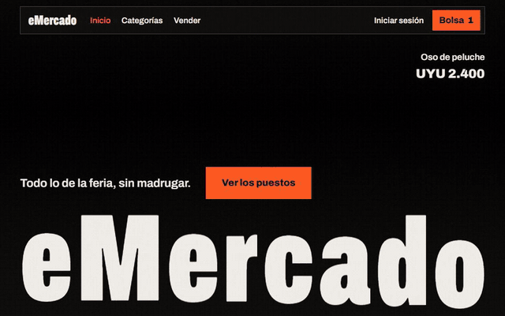

# eMercado

E-commerce de demostración con estética de feria uruguaya, hecho con Angular y Motion. Nació como obligatorio de Jóvenes a Programar en HTML, CSS y JavaScript, y lo migré y rediseñé por completo.

**Probalo:** https://nahuelbenitezs.github.io/Proyecto-Obligatorio/

> Es una demo: no vende ni cobra nada. El checkout, el ingreso y la publicación de productos son simulados.



## Qué tiene

- Catálogo con categorías y productos: búsqueda, orden y filtros por rango.
- Detalle con carrusel, opiniones, puntuación y productos relacionados.
- Bolsa con cantidades, conversión de UYU a USD, envíos y pago simulado.
- Formulario para vender con cálculo de comisión y vista previa de fotos.
- Ingreso de demostración, con Google opcional, y perfil guardado en el navegador.
- Títulos que se ensanchan al bajar, fotos atadas al scroll y transiciones entre páginas. Todo se apaga con `prefers-reduced-motion`.

## Datos

Lee la [API pública del curso](https://github.com/JaPCeibal/emercado-api). Si deja de responder, usa la copia incluida en `public/data`.

## Desarrollo

```bash
npm install
npm start
npm test -- --watch=false
```

Cada push a `main` corre los tests y publica en GitHub Pages.
